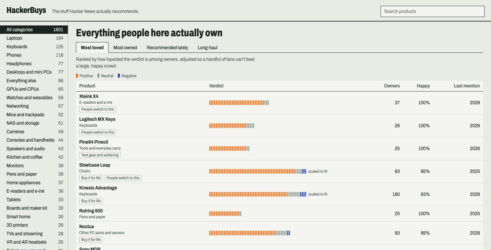
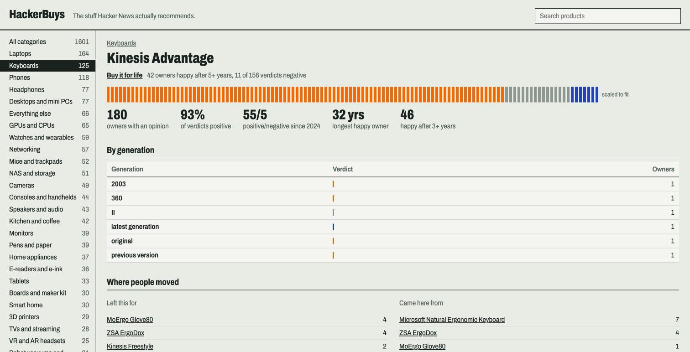
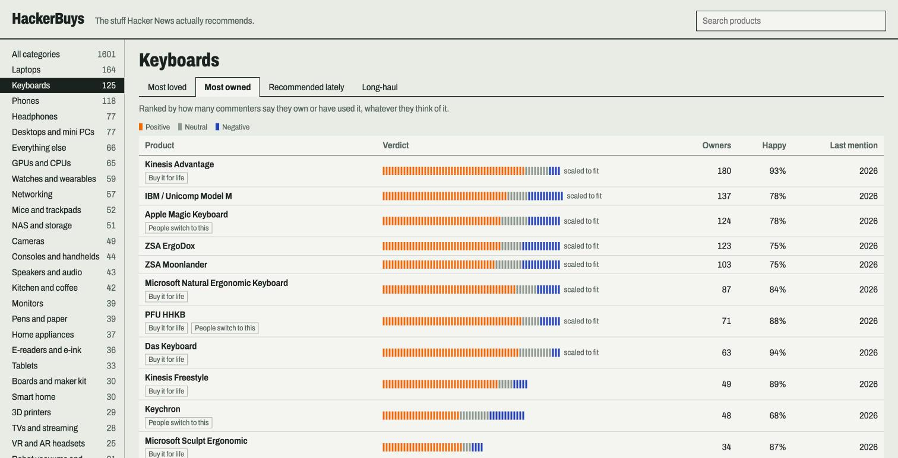
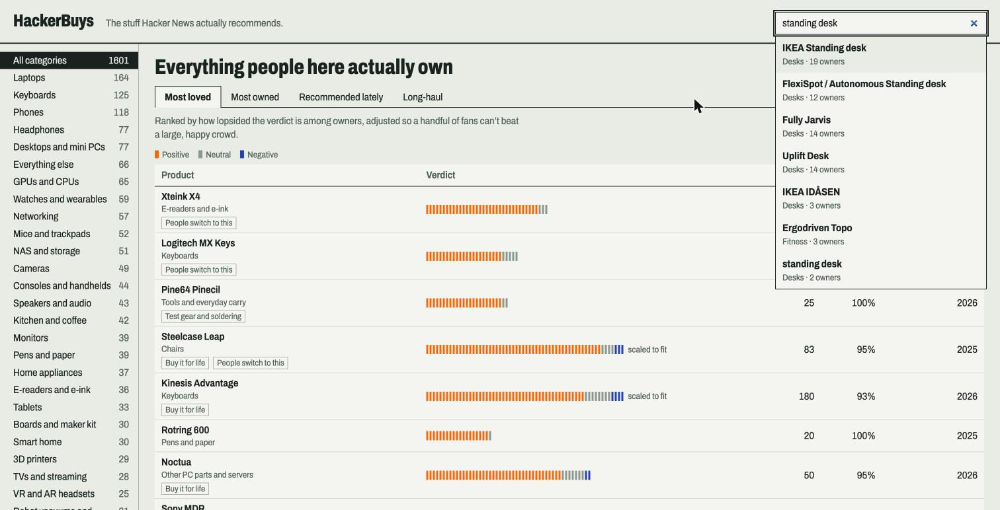
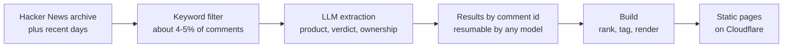

<div align="center">


# HackerBuys

**The stuff Hacker News actually recommends.**

Physical products ranked by the Hacker News commenters who own them, with every opinion linked to its comment.

[**Visit the site**](https://hn.shellbear.me) · [Keyboards](https://hn.shellbear.me/c/keyboards) · [Buy it for life](https://hn.shellbear.me/t/bifl) · [How it works](#how-it-works)

[](https://hn.shellbear.me)
[](LICENSE)
[](https://huggingface.co/datasets/open-index/hacker-news)



</div>

## Why

Hacker News is full of people describing gear they've used for years, like the keyboard they've typed on for a decade or the laptop they regret. Those opinions are buried across millions of threads.

HackerBuys reads those comments and asks three questions: which product is this, did this person actually use it, and what do they think of it? It then ranks products by distinct owners, so one loud commenter counts once.

## Features

- **Rankings four ways:** most loved, most owned, recommended lately and long-haul.
- **Verdicts adjusted for sample size:** 93% from 170 owners can beat 100% from 19.
- **Sources for everything:** each opinion links to the original comment.
- **Ownership details:** years owned, whether it's still going, and which products people moved to or from.
- **Tags from the data:** Buy it for life, People switch to this, Divisive and Skip some generations.
- **Instant search and navigation:** a static site with no server, and nothing you type leaves your browser.

<table>
<tr>
<td width="50%"><br><sub><b>Product pages:</b> verdicts, ownership length and where people moved.</sub></td>
<td width="50%"><br><sub><b>Categories:</b> with sortable columns.</sub></td>
</tr>
<tr>
<td colspan="2"><br><sub><b>Search:</b> matches product types, so "standing desk" also finds Fully Jarvis and Uplift.</sub></td>
</tr>
</table>

## Status

Extraction runs newest first, and the site updates as it progresses.

| | As of November 5, 2026 |
|---|---|
| Comments scanned | 345,879 of about 41 million |
| Complete years | 2025 and most of 2026, among comments that match the product filter |
| Earlier years | A sample chosen to favor likely product opinions, with 2024 in progress |
| Product mentions | 77,130 |
| Ranked products | 1,601 with 3 or more owners |

## How it works



1. **Collect:** the [`open-index/hacker-news`](https://huggingface.co/datasets/open-index/hacker-news) archive through August 2026, then later days from the ClickHouse public demo.
2. **Filter:** regular expressions keep comments that mention a product category or brand. This keeps the cost manageable, but it misses opinions that use none of those words.
3. **Extract:** a model reads comments in batches and returns validated JSON: brand, line, model, type, verdict, first-hand use, years owned, pros, cons and a verbatim quote.
4. **Rank:** the Wilson lower bound over first-hand verdicts, counting each owner once, with neutral verdicts left out.
5. **Publish:** each product and category becomes a real HTML page, with JavaScript adding sorting, search and instant navigation.

### Accuracy

Extraction is automated and makes mistakes, so treat the site as a starting point. Every comment links to its source.

On 400 labeled comments, scored against labels from Claude Sonnet, the current settings reached about **88% precision and 82% recall**, with a margin of about ±7 points. About 97% of extracted quotes appear word for word in their comments.

- Comments that pass the filter but aren't clearly reviews are the noisiest, so rankings rely on first-hand verdicts.
- Rising and Fading tags stay hidden until 2019–2026 are all fully scanned, because comparing years with different coverage would mislead.

## Run it yourself

Requires [uv](https://docs.astral.sh/uv/) and Python 3.12+. Raw data is about 15 GB and isn't in this repo. See [`scripts/01_funnel.py`](scripts/01_funnel.py) and [`scripts/02_enrich.py`](scripts/02_enrich.py) for the filter stage.

```bash
uv sync

# Fetch missing days, newest first (the ClickHouse demo allows 60,000 rows an hour)
.venv/bin/python scripts/21_backfill.py 2026-08-22 2026-11-03

# Queue candidates, newest year first
.venv/bin/python scripts/22_build_queue.py data/extract/queue.parquet

# Extract: stop any time, and rerunning continues where it left off
.venv/bin/python scripts/23_extract.py --adapter codex --model gpt-6-luna --workers 8 --max-credits 50
.venv/bin/python scripts/26_progress.py

# Build the site, then preview it
.venv/bin/python scripts/14_build_site.py
npx wrangler dev

# Test
.venv/bin/python -m unittest tests.test_extract_lib tests.test_site_render
node --test tests/site_sort.test.cjs
```

The Codex adapter re-reads your balance before each batch. It stops below `--floor`, at `--max-credits`, if the balance rises, or on a spending limit. A Haiku adapter is included, but it hasn't been run yet.

Pushes to `main` deploy to Cloudflare Workers automatically.

## Project layout

```text
scripts/    filter, queue, extraction and site build
site/       the published site: generated pages plus app.js, sort.js and style.css
extract/    extraction results, one JSON file per batch
analysis/   feasibility report, evaluation sets and labels
tests/      Python and JavaScript tests
```

Early findings are in [`analysis/REPORT.md`](analysis/REPORT.md).

## Credits

- Comments by the Hacker News community, through [`open-index/hacker-news`](https://huggingface.co/datasets/open-index/hacker-news) (ODC-BY) and the [ClickHouse public demo](https://sql-clickhouse.clickhouse.com).
- Inspired by HackerBooks and HackerTube.
- Not affiliated with Y Combinator.

## License

Code is [MIT](LICENSE). Hacker News data keeps its own license and belongs to its authors.

Made by [shellbear](https://shellbear.me).
